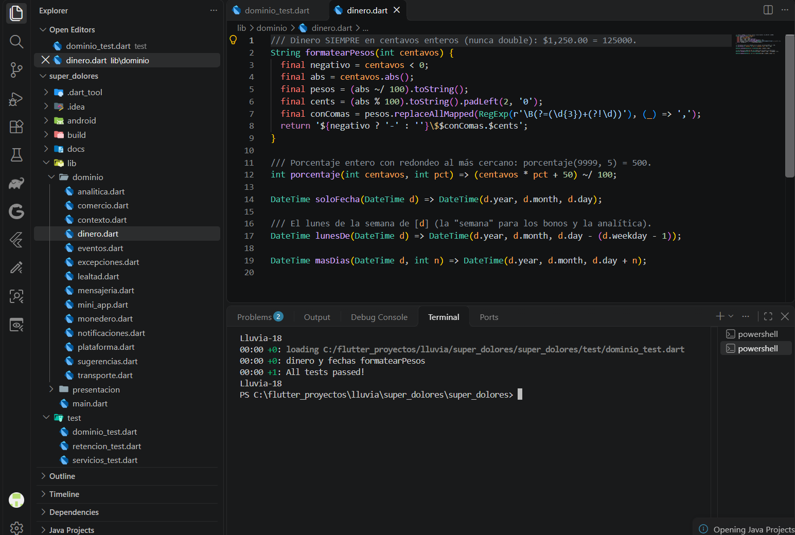
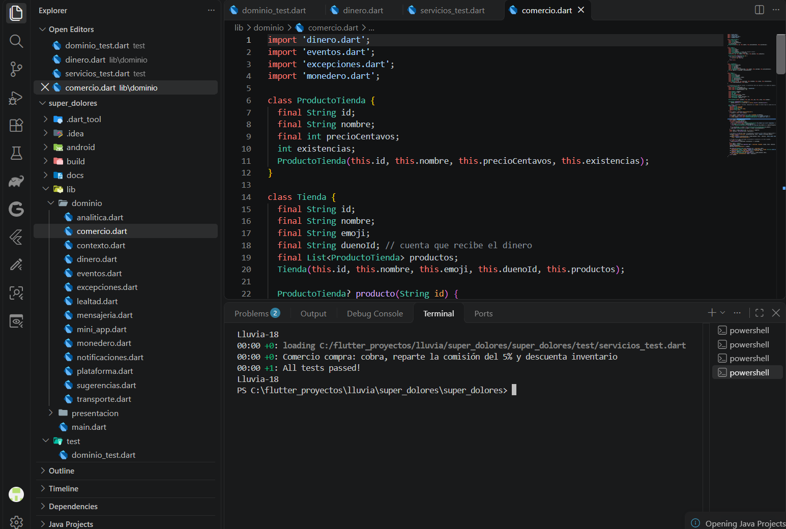
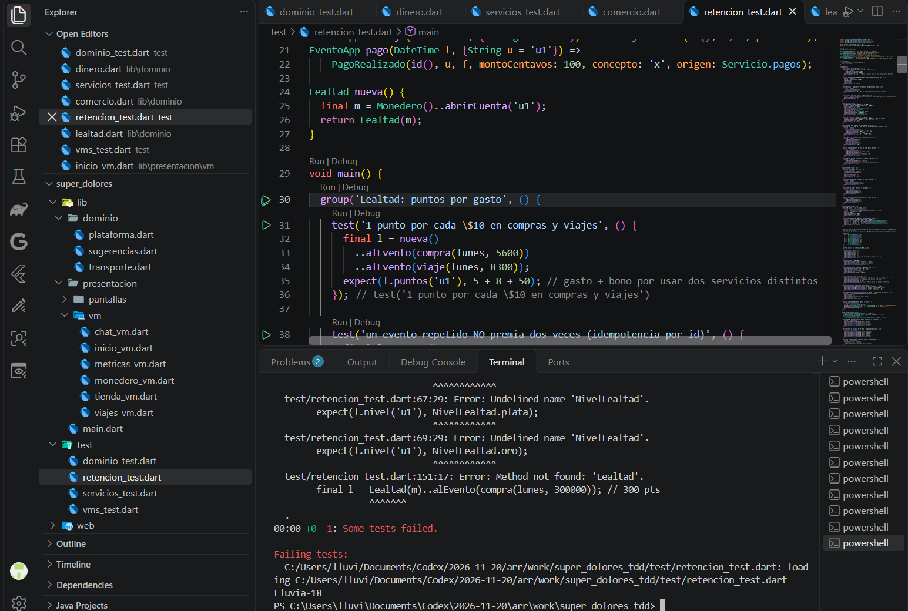
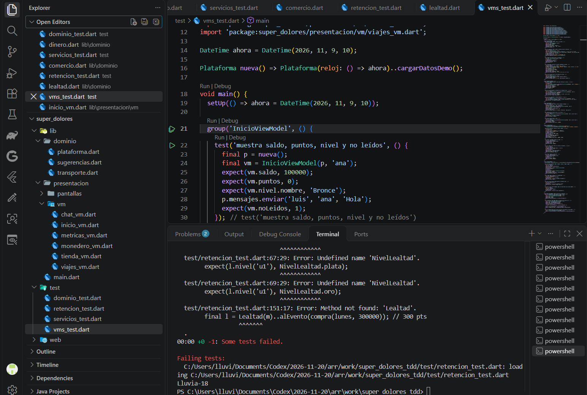
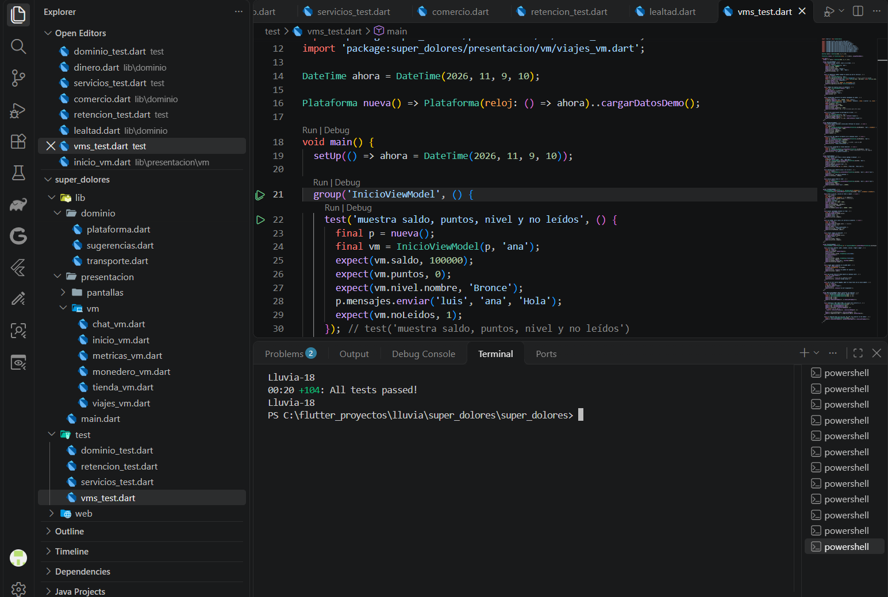
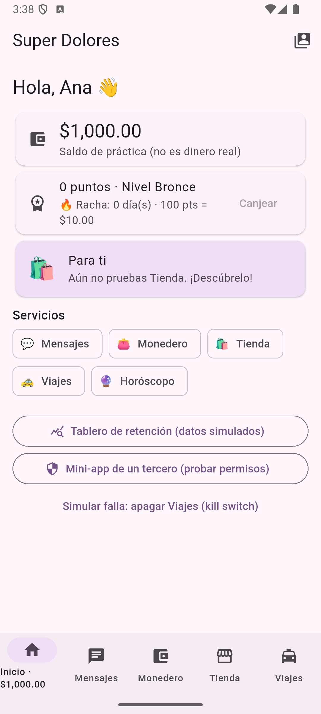

# Super Dolores

Lluvia Villanueva 

SuperApp didáctica desarrollada en Flutter con TDD. Integra mensajería, monedero, comercio local, transporte, mini-apps, lealtad, analítica de retención, notificaciones éticas y sugerencias dentro de un mismo ecosistema.


## Ronda 1 · Dominio de la SuperApp

El archivo `dominio_test.dart` comprueba dinero y fechas, monedero, transferencias atómicas, idempotencia, límites diarios, bus de eventos, mensajería, mini-apps, permisos y kill switch.

### Fase roja


### Fase verde



## Ronda 2 · Comercio y transporte

El archivo `servicios_test.dart` valida compras, inventario, comisión, conservación del dinero, cálculo de distancia, tarifa dinámica, estados del viaje, cancelaciones e integración entre servicios.

### Fase roja


### Fase verde



## Ronda 3 · Lealtad, retención y notificaciones

El archivo `retencion_test.dart` comprueba puntos, niveles, bonos semanales, rachas, canjes, DAU/WAU/MAU, cohortes, notificaciones éticas y sugerencias personalizadas.

### Fase roja



### Fase verde


## Ronda 4 · ViewModels

El archivo `vms_test.dart` verifica los ViewModels de inicio, monedero, chat, tienda, viajes y métricas, incluyendo errores claros y actualización de la interfaz.

### Fase roja



### Fase verde


## Ejecución completa de pruebas

Los cuatro archivos se ejecutaron juntos. El resultado final fue de **104 pruebas aprobadas**.



## Aplicación terminada

La aplicación se compiló, instaló y ejecutó correctamente en un emulador Android.



## Ejecutar el proyecto

```powershell
flutter pub get
flutter test
flutter run
```
