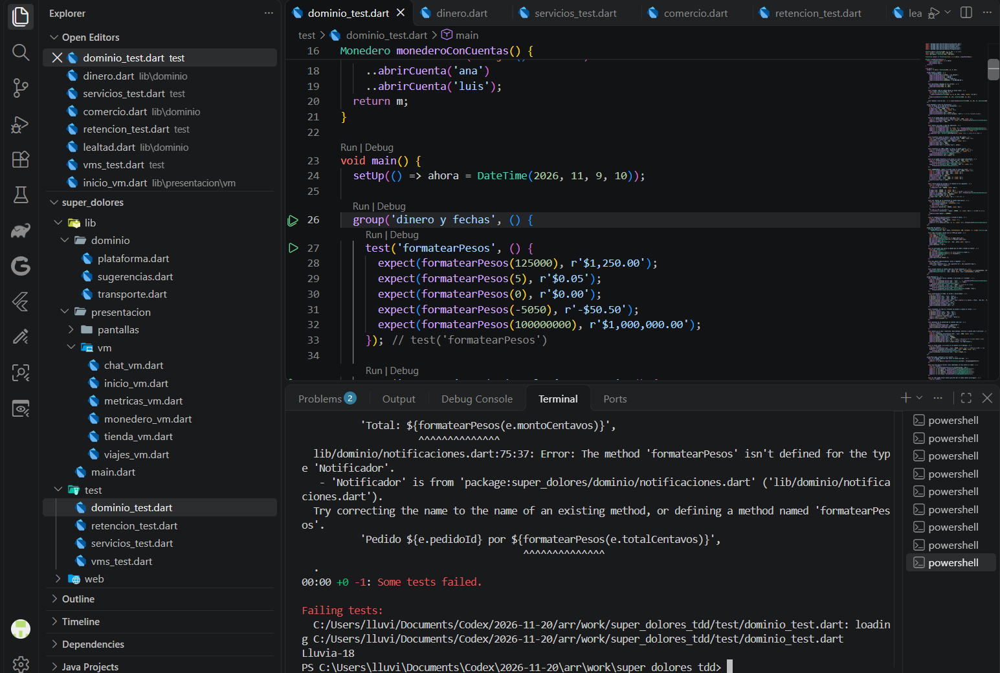
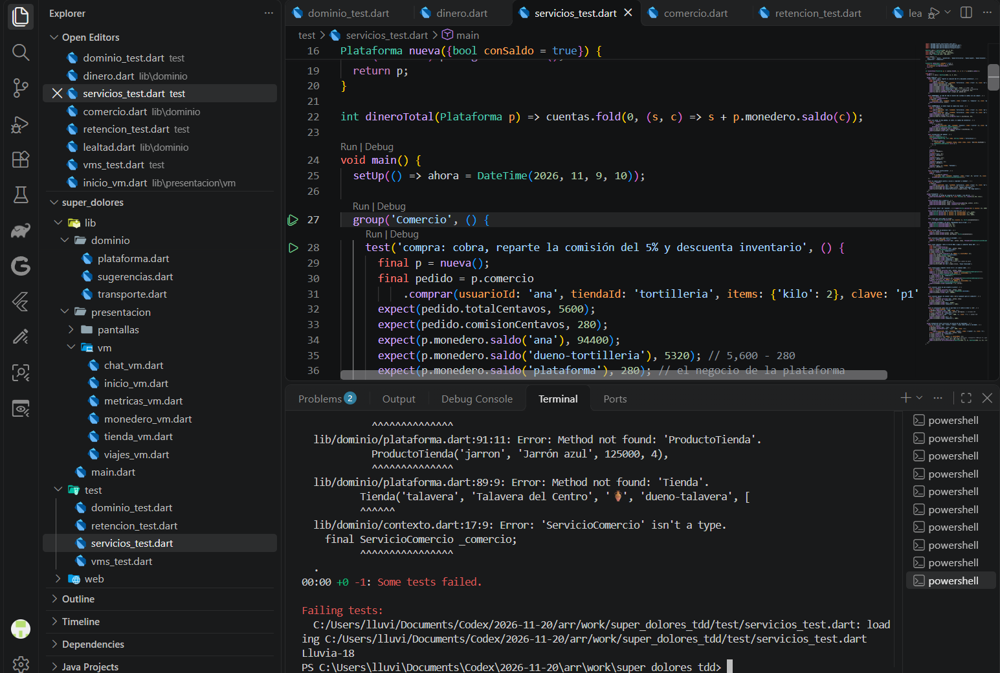
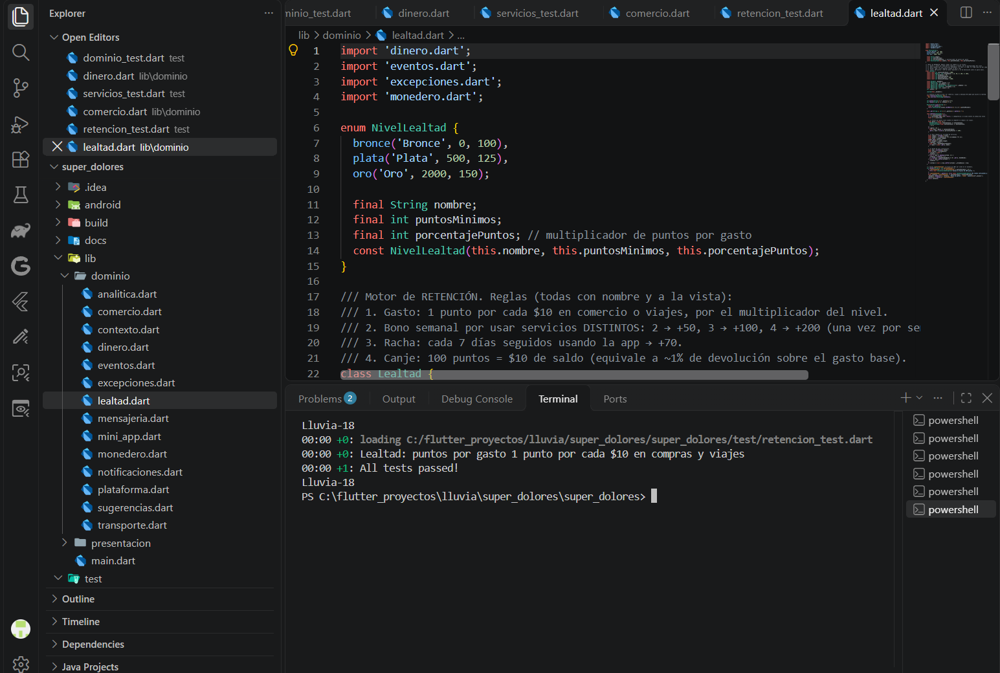
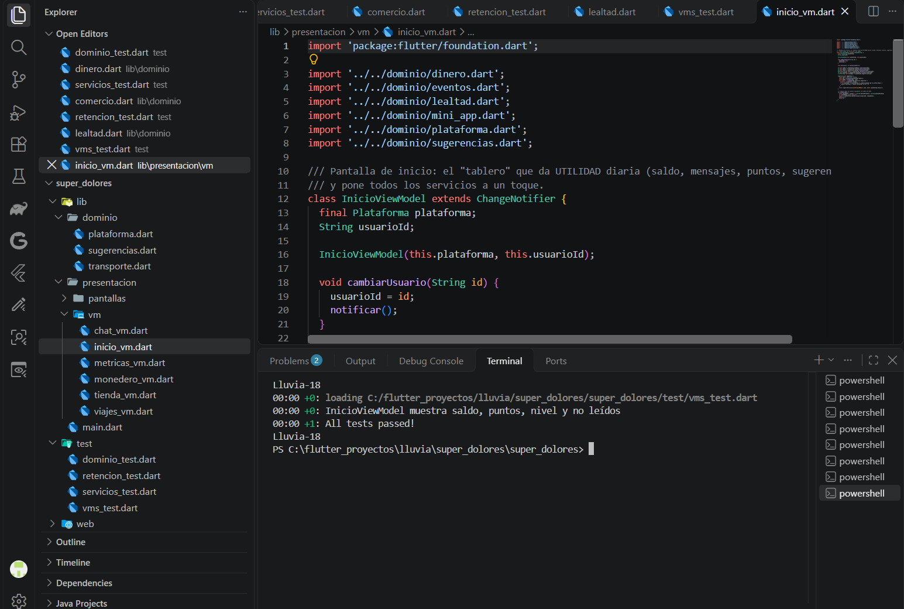

# Super Dolores

**Autora:** Lluvia Villanueva (`Lluvia-18`)

SuperApp didáctica desarrollada en Flutter con TDD. Integra mensajería, monedero, comercio local, transporte, mini-apps, lealtad, analítica de retención, notificaciones éticas y sugerencias dentro de un mismo ecosistema.

> Los saldos, viajes, compras y métricas son simulados con fines educativos. La aplicación no mueve dinero real ni presta servicios de transporte.

## Metodología TDD

Cada bloque principal se documentó mediante el ciclo **Rojo → Verde**:

- **Fase roja:** las pruebas se ejecutan sin la implementación correspondiente y fallan.
- **Fase verde:** la implementación satisface el comportamiento esperado y las pruebas pasan.

Las capturas muestran el código, la terminal, el resultado de cada ronda y el usuario de Git `Lluvia-18`.

## Ronda 1 · Dominio de la SuperApp

El archivo `dominio_test.dart` comprueba dinero y fechas, monedero, transferencias atómicas, idempotencia, límites diarios, bus de eventos, mensajería, mini-apps, permisos y kill switch.

### Fase roja



### Fase verde


## Ronda 2 · Comercio y transporte

El archivo `servicios_test.dart` valida compras, inventario, comisión, conservación del dinero, cálculo de distancia, tarifa dinámica, estados del viaje, cancelaciones e integración entre servicios.

### Fase roja



### Fase verde


## Ronda 3 · Lealtad, retención y notificaciones

El archivo `retencion_test.dart` comprueba puntos, niveles, bonos semanales, rachas, canjes, DAU/WAU/MAU, cohortes, notificaciones éticas y sugerencias personalizadas.

### Fase roja


### Fase verde



## Ronda 4 · ViewModels

El archivo `vms_test.dart` verifica los ViewModels de inicio, monedero, chat, tienda, viajes y métricas, incluyendo errores claros y actualización de la interfaz.

### Fase roja


### Fase verde



## Ejecución completa de pruebas

Los cuatro archivos se ejecutaron juntos. El resultado final fue de **104 pruebas aprobadas**.


## Aplicación terminada

La aplicación se compiló, instaló y ejecutó correctamente en un emulador Android.


## Funcionalidades

- Mensajería entre usuarios y envío de dinero desde el chat.
- Monedero con movimientos, transferencias y controles de idempotencia.
- Comercio local con inventario y comisión de plataforma.
- Transporte con distancia Haversine, tarifa y máquina de estados.
- Mini-apps con permisos de mínimo privilegio y kill switch.
- Programa de lealtad con puntos, niveles, rachas, bonos y canjes.
- Métricas de retención con datos sintéticos reproducibles.
- Notificaciones promocionales con límites y horas de silencio.

## Estructura

- `lib/dominio/`: reglas de negocio y servicios de la plataforma.
- `lib/presentacion/vm/`: ViewModels de cada módulo.
- `lib/presentacion/pantallas/`: interfaz de la SuperApp.
- `test/`: cuatro archivos principales con 104 pruebas.

## Verificación

- `flutter analyze`: sin problemas.
- `flutter test`: 104 pruebas aprobadas.
- `flutter build apk --debug`: APK generado correctamente.
- Ejecución comprobada en `emulator-5554`.

## Ejecutar el proyecto

```powershell
flutter pub get
flutter test
flutter run
```
